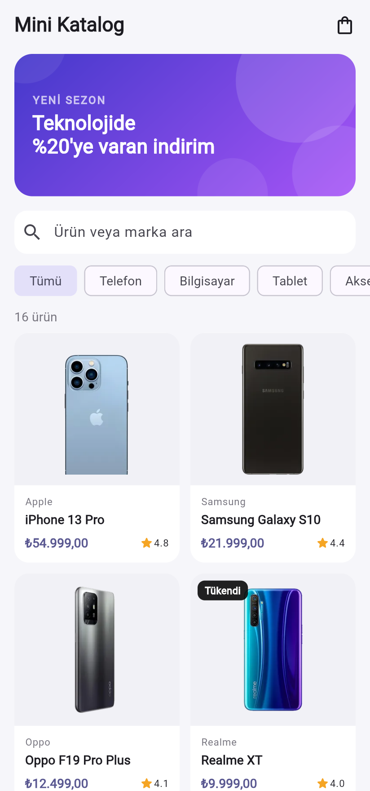
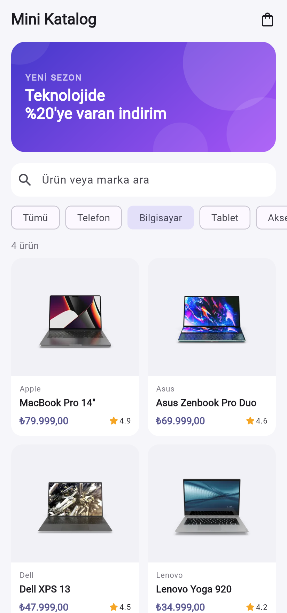
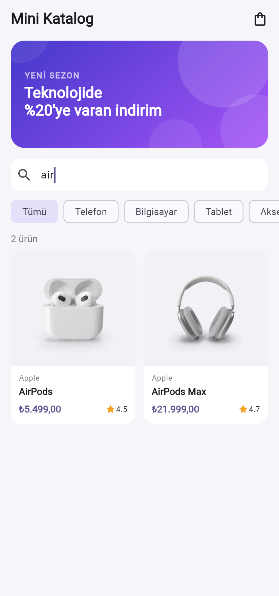
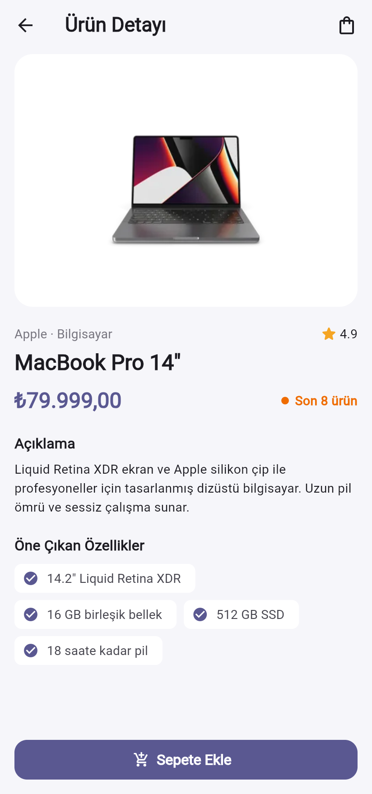
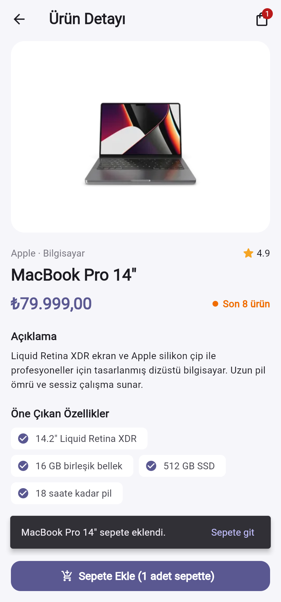
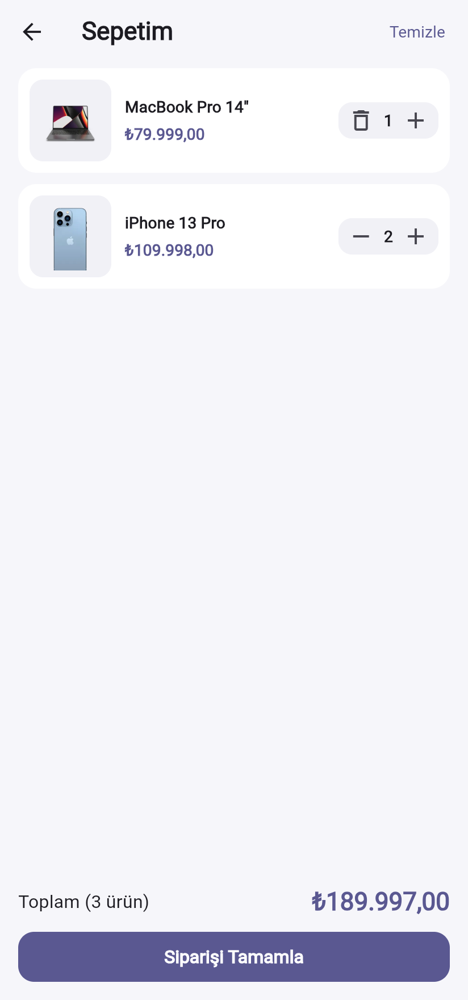
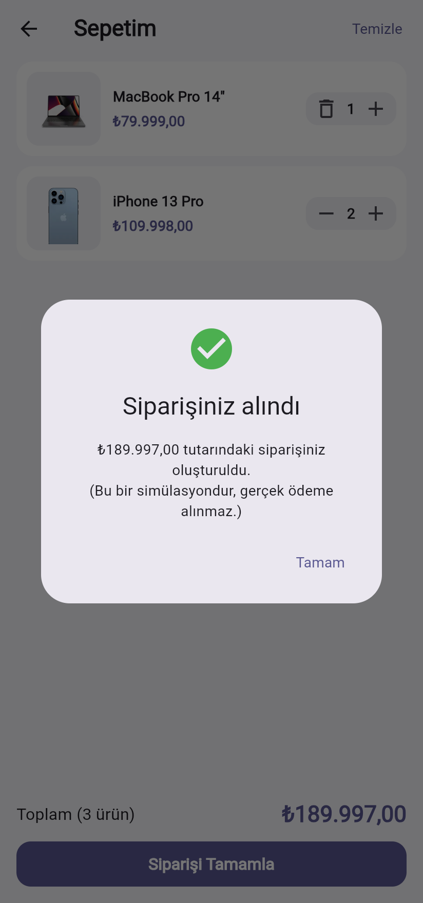

# Mini Katalog Uygulaması

Flutter ile geliştirilmiş, ürünleri listeleyen, ürün detayını gösteren ve basit bir sepet simülasyonu içeren eğitim amaçlı mobil uygulama.

Uygulama yalnızca Flutter SDK (`material.dart`) ile yazılmıştır, **ekstra paket kullanılmamıştır**. Ürün verisi gerçek bir API yerine `assets/data/products.json` dosyasından okunarak bir API cevabı simüle edilir.

## Ekran Görüntüleri

| Ana sayfa | Kategori filtresi | Arama |
|:---:|:---:|:---:|
|  |  |  |

| Ürün detayı | Sepete ekleme | Sepet | Sipariş |
|:---:|:---:|:---:|:---:|
|  |  |  |  |

## Özellikler

- **Ana sayfa:** Banner (`Image.asset`), arama kutusu, kategori filtreleri (`ChoiceChip`) ve ürün kartları grid'i (`SliverGrid`, ekran genişliğine göre 2/3/4 sütun)
- **Arama ve filtreleme:** Ürün adı veya markaya göre anlık arama, kategoriye göre filtreleme
- **Ürün detayı:** Görsel, marka, puan, fiyat, stok durumu, açıklama ve öne çıkan özellikler
- **Sayfa geçişleri:** Named routes ve `onGenerateRoute`. Ürün detay sayfasına ürün, **Route Arguments** ile taşınır
- **Sepet simülasyonu:** Sepete ekleme, adet arttırma/azaltma, silme, toplam tutar ve sipariş tamamlama diyaloğu. Stok sınırı kontrol edilir
- **State yönetimi:** Flutter'ın kendi `ChangeNotifier` + `InheritedNotifier` yapısı (paket yok)
- **Model sınıfı:** `Product` için `fromJson` / `toJson`
- **Tema:** Material 3, tek bir seed renginden üretilen basit uygulama teması

## Kullanılan Sürümler

| Araç | Sürüm |
|---|---|
| Flutter | 3.47.7 (stable) |
| Dart | 3.13.5 |

## Proje Yapısı

```
lib/
├── main.dart                     # Uygulama girişi, MaterialApp ve CartScope
├── app/
│   ├── routes.dart               # Named route'lar ve route argümanları
│   └── theme.dart                # Uygulama teması
├── models/
│   └── product.dart              # Ürün modeli (fromJson / toJson)
├── data/
│   └── product_repository.dart   # JSON asset'ten ürünleri okuma (API simülasyonu)
├── state/
│   └── cart.dart                 # Sepet durumu (ChangeNotifier + InheritedNotifier)
├── screens/
│   ├── home_screen.dart          # Ana sayfa: banner, arama, filtre, grid
│   ├── product_detail_screen.dart
│   └── cart_screen.dart
├── widgets/
│   ├── product_card.dart
│   ├── product_image.dart        # Ağ görseli + yerel yer tutucu
│   ├── promo_banner.dart
│   └── cart_button.dart          # Rozetli sepet butonu
└── utils/
    └── formatters.dart           # Türkçe fiyat biçimlendirme (₺54.999,00)

assets/
├── data/products.json            # Ürün verisi (16 ürün, 5 kategori)
└── images/                       # banner.png, placeholder.png

test/widget_test.dart             # Model, sepet, biçimlendirme ve akış testleri
screenshots/                      # Uygulama ekran görüntüleri
```

## Çalıştırma Adımları

1. [Flutter SDK](https://docs.flutter.dev/get-started/install)'yı kurun ve `flutter doctor` ile ortamı kontrol edin.
2. Android Studio'dan bir Android Emulator başlatın veya fiziksel bir cihaz bağlayın.
3. Depoyu klonlayın ve proje klasörüne girin:
   ```bash
   git clone https://github.com/barisbirdal/mini_katalog.git
   cd mini_katalog
   ```
4. Bağımlılıkları yükleyin:
   ```bash
   flutter pub get
   ```
5. Uygulamayı çalıştırın:
   ```bash
   flutter run
   ```
   Tarayıcıda denemek için: `flutter run -d chrome`

Testleri çalıştırmak için:

```bash
flutter test
```

## Veri Kaynakları

Ürün görselleri ve ürün bilgileri, yönergede alternatif test API'si olarak önerilen [DummyJSON](https://dummyjson.com/products) verisinden uyarlanmıştır. Ürün görselleri ağdan yüklenir, yüklenemezse yerel yer tutucu görsel gösterilir. Fiyatlar ve açıklamalar eğitim amaçlı örnek verilerdir ve gerçek bir e-ticaret altyapısını temsil etmez.
